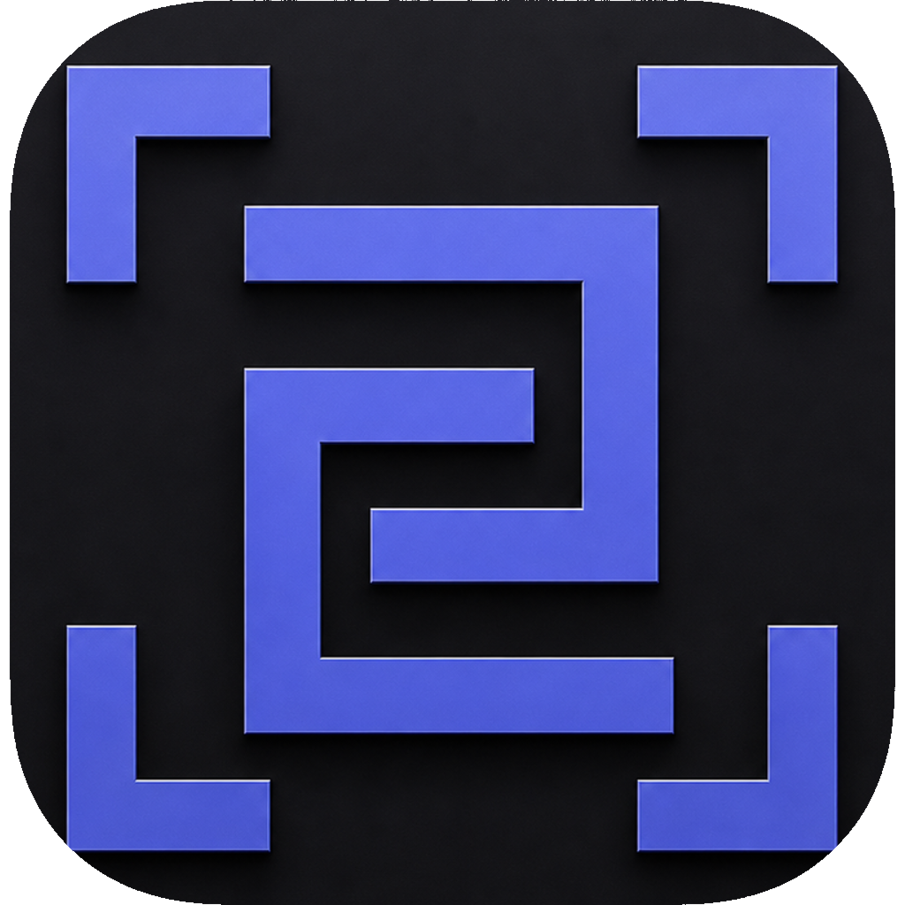
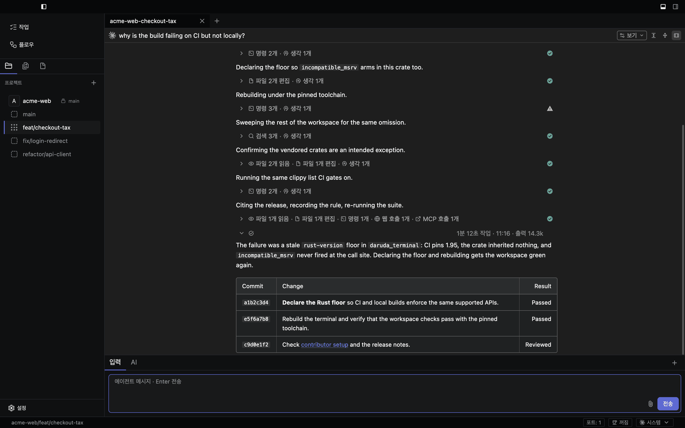
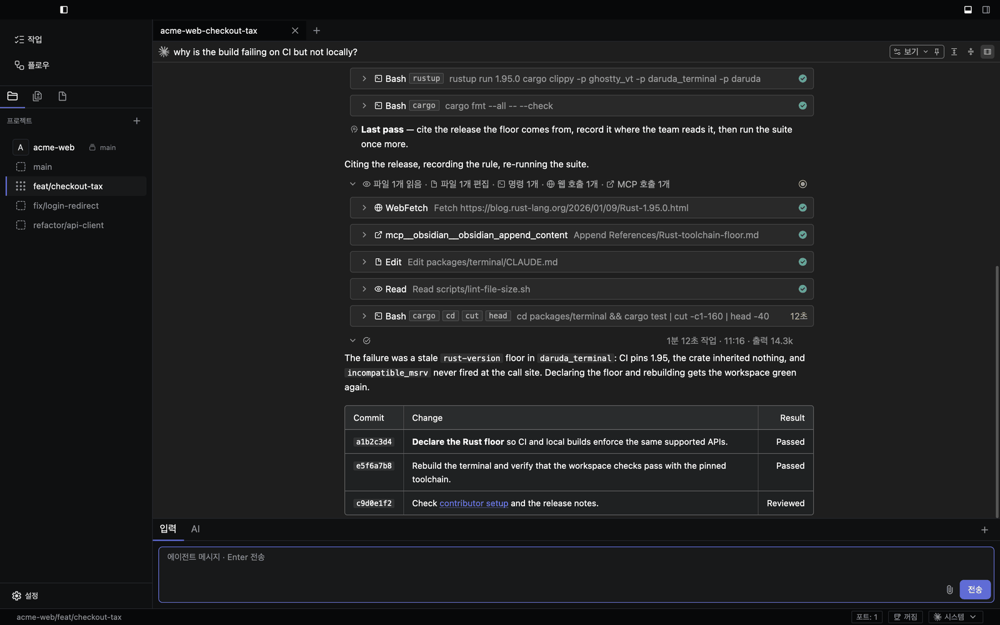
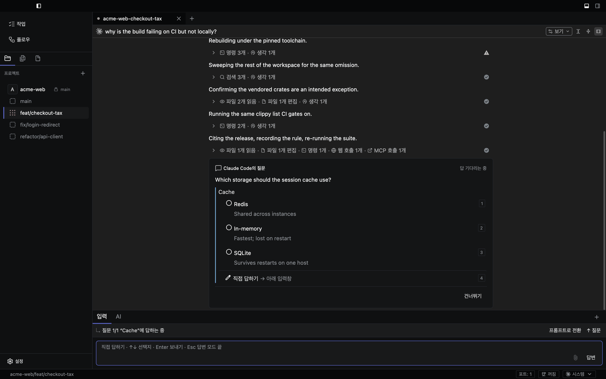
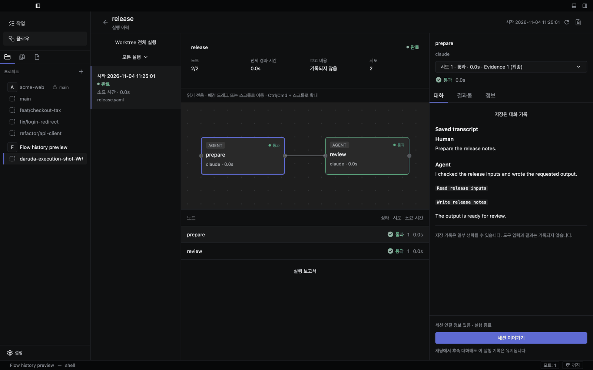
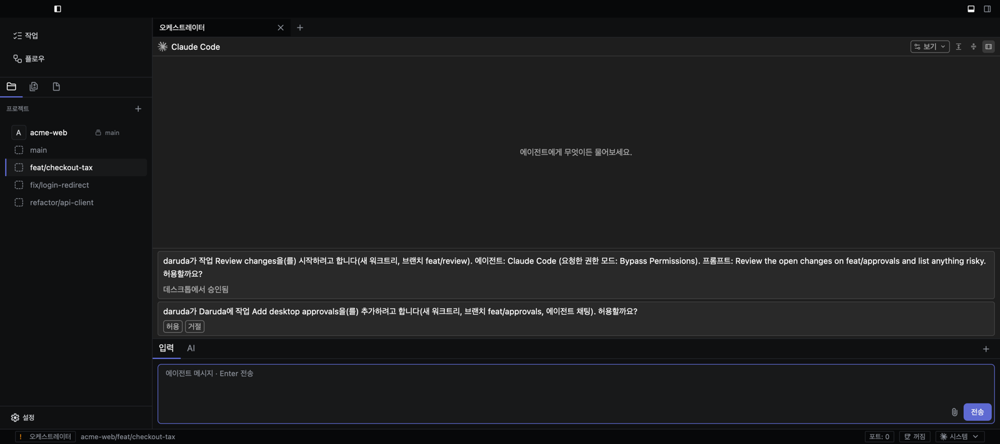
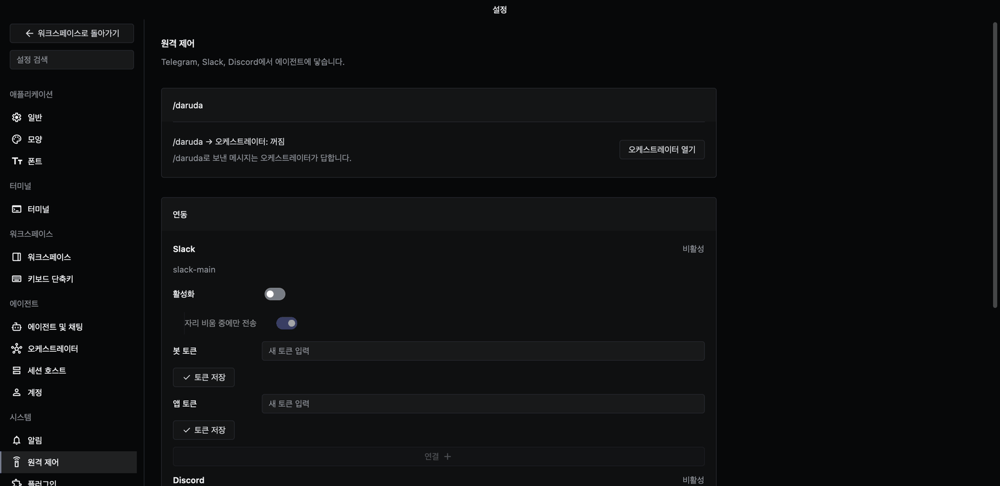
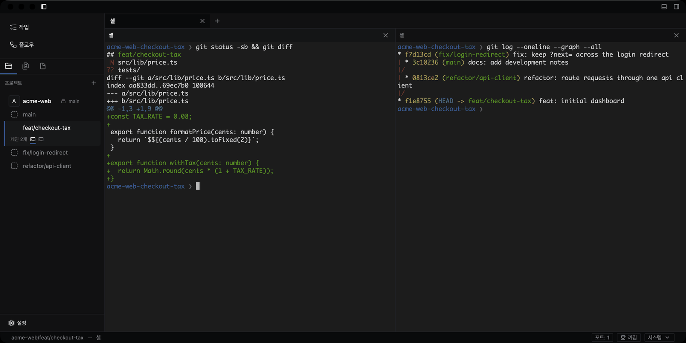

<div align="center">



# daruda

**Keep the vibe. Try every idea.**

Claude Code, Codex, Gemini 등 여러 코딩 에이전트를 하나의 네이티브 데스크톱
창에서 나란히 실행하고, 작업마다 별도의 git worktree에서 돌립니다.

[**다운로드**](https://github.com/daruda-ai/daruda/releases/latest) &nbsp;&bull;&nbsp;
[변경 내역](https://github.com/daruda-ai/daruda/releases) &nbsp;&bull;&nbsp;
[기여 안내](CONTRIBUTING.md) &nbsp;&bull;&nbsp;
[이슈 제보](https://github.com/daruda-ai/daruda/issues/new)

[](https://github.com/daruda-ai/daruda/releases/latest)
[](https://github.com/daruda-ai/daruda/actions/workflows/ci.yml)
[](LICENSE)


[English](README.md) · 한국어



</div>

## daruda란?

daruda는 에이전트 개발 환경(ADE)입니다. 터미널 탭과 브랜치를 손으로
관리하지 않고도 여러 AI 코딩 에이전트를 동시에 돌릴 수 있는 데스크톱
앱입니다. 작업마다 별도의 git worktree를 주므로, 한 저장소에서 여러
에이전트가 서로 다른 변경을 동시에 진행할 수 있습니다.

이미 코딩 에이전트를 쓰고 있고, 둘 이상을 한곳에서 감독하고 싶은 개발자를
위한 도구입니다. 에이전트의 도구 호출을 지켜보고, 질문에 답하고, 권한
요청을 승인하고, diff를 검토하는 일을 한 화면에서 합니다.

daruda는 코딩 에이전트 자체가 아닙니다. 에이전트 구독과 API 키는 직접
준비합니다. 에이전트는 내 컴퓨터에서 실행되어 각 제공자와 직접 통신하며,
daruda는 모델 호출을 중계하지 않습니다.

## daruda의 차별점

- **Electron이 아닌 네이티브 앱.** Zed의 UI 프레임워크인
  [GPUI](https://github.com/zed-industries/zed/tree/main/crates/gpui)와
  [Ghostty](https://ghostty.org) 터미널 코어를 바탕으로 Rust로 만들었습니다.
- **채팅이 기본.** 에이전트는 터미널뿐 아니라 구조화된
  [ACP](https://agentclientprotocol.com) 채팅 창에서 실행됩니다. 도구 호출은
  카드로, 파일 수정은 단어 단위 diff로, 권한 요청은 앱 안의 승인 버튼으로
  보입니다. 모델, 추론 강도, 권한 모드도 채팅 창에서 바로 고릅니다.
- **반복 가능한 Flow.** 여러 단계 작업을 YAML Flow로 정의합니다. 에이전트
  노드, 명령 게이트, 병렬 분기를 쓸 수 있고, 그래프로 편집하며, 앱이 비정상
  종료돼도 실행을 이어서 재개합니다.
- **Worktree 격리.** 서로 독립된 작업은 각자의 디렉터리와 브랜치를 가진
  별도 worktree에서 진행합니다. 셸이 더 맞는 작업이면 터미널도 바로 열 수
  있습니다.
- **오픈소스.** 앱 전체가 AGPL-3.0입니다.

## 설치

[GitHub Releases](https://github.com/daruda-ai/daruda/releases/latest)에서
최신 빌드를 내려받습니다.

| 플랫폼 | 파일 | 참고 |
|---|---|---|
| macOS 12 이상 (Apple Silicon, Intel) | `daruda-<version>.dmg` | 유니버설 빌드 하나로 둘 다 지원합니다. daruda.app을 응용 프로그램 폴더로 끌어 놓습니다. |
| Windows x86_64 / ARM64 | `daruda-<version>-windows-<arch>-setup.exe` 또는 `.zip` | 사용자 단위로 설치되며 관리자 권한이 필요 없습니다. GUI 지원은 실험 단계입니다. |
| Linux x86_64 | `daruda-<version>-linux-x86_64.deb` 또는 `.tar.gz` | Vulkan 드라이버가 필요합니다 (Debian, Ubuntu는 `mesa-vulkan-drivers`). |

**macOS 첫 실행:** 아직 공증(notarization)을 받지 않은 빌드입니다.
daruda.app을 오른쪽 클릭하고 **열기**를 고릅니다. 그래도 열리지 않으면
다음을 실행합니다.

```bash
xattr -cr /Applications/daruda.app
```

**Windows:** 서명되지 않은 빌드는 SmartScreen 경고가 나올 수 있습니다.
ZIP을 쓸 때는 전체를 압축 해제하고, 함께 든 DLL을 `daruda.exe` 옆에 그대로
둡니다.

**Debian, Ubuntu:** `sudo apt install ./daruda-<version>-linux-x86_64.deb`로
설치합니다. 다른 배포판에서는 tar.gz를 풀고 `./daruda`를 실행합니다.

모든 릴리스에는 `SHA256SUMS.txt`가 들어 있습니다.
`sha256sum -c SHA256SUMS.txt`(Windows는 `Get-FileHash`)로 내려받은 파일을
확인할 수 있습니다.

[Git](https://git-scm.com/)과, 로그인해 둔 코딩 에이전트(Claude Code나 Codex
등)가 하나 이상 있어야 합니다.

## 첫 작업 시작하기

1. **프로젝트 추가**를 누르고 내 컴퓨터의 저장소를 고릅니다.
2. 프로젝트 헤더에 마우스를 올려 **+** 버튼을 누르고 브랜치 이름을 정해 작업용
   **워크트리 생성**을 합니다. daruda가 브랜치와 형제 디렉터리를 만듭니다.
3. **새 에이전트 채팅**을 열고 에이전트를 고른 뒤 작은 변경을 요청합니다.
   도구 호출을 지켜보고, 질문에 답하고, 커밋 전에 diff를 검토합니다.

같은 worktree의 채팅은 파일과 브랜치를 공유합니다. 서로 독립된 작업은 각자의
worktree에서 시작하세요. `Cmd+Ctrl+1-9`(Windows, Linux는 `Ctrl+Alt+1-9`)로
현재 프로젝트의 worktree 사이를 이동합니다.

## 기능

### 모든 도구 호출 검토

에이전트가 하는 일은 단계마다 카드로 보입니다. 명령 실행, 파일 읽기와 수정,
웹 요청, MCP 호출이 각각의 상태, 소요 시간과 함께 표시되고, 펼치면 입력과
출력을 볼 수 있습니다.



### 그 자리에서 에이전트에게 답하기

에이전트가 질문하거나 권한을 요청하면 선택지와 함께 대화 안에 나타나고,
입력창이 바로 답변 모드로 바뀝니다.



### Flow 실행과 노드별 확인

Flow는 에이전트 단계와 명령 단계를 이어 붙입니다. 실행 화면에서 그래프,
노드별 상태와 시도 횟수, 각 노드의 저장된 대화를 확인할 수 있습니다.



### 오케스트레이터에게 맡기기

오케스트레이터는 `/daruda`로 부르는 상주 에이전트입니다. worktree 만들기,
작업과 Flow 시작, 다른 에이전트에게 메시지 보내기를 대신 맡길 수 있습니다.
worktree, 채팅, 작업을 만들거나 작업을 시작하기 전에는 채팅 안의 승인
카드로 먼저 확인받습니다. 앱을 켤
때가 아니라 첫 요청을 받을 때 시작합니다.
휴대폰이나 오케스트레이터가 연 채팅과 작업은 에이전트마다 정한 **자동 실행
모드**로 실행되며, 에이전트별로 **설정 › 에이전트 및 채팅**에서 바꿀 수
있습니다. Claude와 Codex는 기본값이 권한을 묻지 않는 모드이고, 다른
에이전트는 세션 모드를 따릅니다.



### Telegram, Slack, Discord에서 에이전트에게 지시하기

원격 제어로 봇을 연결하면 휴대폰에서 오케스트레이터와 에이전트에게 메시지를
보내고, 결과를 받고, 승인 요청에 답할 수 있습니다. **자리 비움 중에만 전송**을
켜면 daruda를 비웠을 때만 메시지가 전달됩니다.

Slack이나 Discord 봇은 응답을 받을 곳에서 연결합니다. 봇과의 DM에서 연결하면
본인만 보고, 채널에서 연결하면 그 채널 구성원이 코드와 파일 경로를 포함한
에이전트 응답을 볼 수 있으며 에이전트 조작은 본인만 할 수 있습니다. 그곳의
메시지는 워크스페이스의 다른 메시지처럼 보존·내보내기 설정을 따릅니다.



### 같은 창 안의 터미널

터미널 창은 Ghostty 터미널 엔진을 씁니다. 에이전트 채팅 옆에 분할해 셸, CLI
에이전트, 일회성 TTY 작업에 쓰며, IME 입력, 스크롤백 검색, 프롬프트 표시를
지원합니다.



**그 밖의 기능:**

- **MCP 서버로서의 daruda:** MCP 클라이언트에 `daruda --mcp`를 등록하면
  daruda가 실행 중일 때 에이전트가 worktree와 채팅을 만들고, 메시지를 보내고,
  작업과 Flow를 실행하고, 결과를 기다릴 수 있습니다.
- **세션 호스트:** worktree의 에이전트를 SSH 호스트나 Docker 컨테이너에서
  실행합니다.
- **여러 계정:** Claude와 Codex 계정을 여러 개 등록하고 창마다 골라 씁니다.
  자격 증명은 계정별로 분리됩니다.
- **사용 한도:** 상태 표시줄에서 사용 한도를 확인하고, 추가 요금이 붙기 전에
  자동으로 멈추게 할 수 있습니다.
- **잠자기 방지:** 에이전트가 일하거나 승인을 기다리는 동안 컴퓨터가 잠들지
  않게 합니다.
- **알림:** 에이전트 작업이 끝났을 때, 오래 걸리는 명령이 끝났을 때, 터미널
  에이전트가 질문하려고 멈췄을 때 알려 줍니다.
- **채팅 세부 기능:** 프롬프트 대기열, 파일과 이미지 첨부, 서브에이전트 진행
  상황, 에이전트의 계획 표시.
- **작업 공간 뷰:** Markdown, Mermaid, 이미지 미리보기를 지원하는 파일 보기,
  git 변경 사항, 작업, 스킬, MCP 도구, worktree별 포트.
- **작업(Task):** 작업을 한 번 작성해 두고 새 worktree나 기존 worktree에서
  시작합니다.
- **내 취향대로:** 다크·라이트 테마, 터미널·편집기·채팅별 글꼴, 단축키 변경,
  상태 아이콘 플러그인, 한국어·English UI.
- **세션 복원:** 탭, 창 분할, 패널, worktree 배치가 재시작 후에도 유지됩니다.

## 지원 에이전트

daruda에는 에이전트 38개의 ACP 프리셋이 들어 있습니다. 예를 들면 다음과
같습니다.

Claude Agent · Codex · Gemini CLI · GitHub Copilot · Cursor · OpenCode ·
Amp · Factory Droid · Devin · goose · Kimi CLI · Qwen Code · Mistral Vibe ·
Cline · Junie · Kilo · Auggie CLI · Grok Build

**설정 → 에이전트 및 채팅**에서 설치하고 켭니다. 그 밖의 CLI 에이전트는
터미널 창에서 실행할 수 있습니다.

## 현재 상태

| 영역 | 상태 |
|---|---|
| macOS | 주 지원 대상, Apple Silicon과 Intel |
| Windows | 네이티브 x86_64, ARM64용 ZIP과 설치 프로그램 제공. GUI 지원은 실험 단계. CI에서 x86_64는 빌드·테스트·실행 확인, ARM64는 빌드·실행 확인 |
| Linux | x86_64용 `.deb`와 tar.gz 제공. CI에서 빌드·테스트하고 Xvfb와 sway에서 창이 뜨는지 확인. 실제 데스크톱 환경(입력, IME, 메뉴)은 아직 검증 전 |
| ACP 채팅 세션 | 설정된 ACP 에이전트에서 지원 |
| Claude Code 연동 | 상태, 사용량, 스킬, 도구 지원 |
| 그 밖의 에이전트 연동 | 각 CLI가 안정적인 메타데이터를 제공하는 대로 진행 중 |

## 로드맵

- 더 많은 에이전트에 대해 제공자별 상태, 사용량, 스킬, 도구 지원
- Linux, Windows 데스크톱 실행 환경 검증
- macOS에서 앱 이름으로 보내는 네이티브 알림
- macOS Developer ID 코드 서명, 공증, Homebrew Cask 배포
- Kitty 키보드 프로토콜, vi 방식 스크롤백 이동, 이미지 프로토콜 지원

## 소스에서 빌드하기

daruda 자체를 개발하려면 소스에서 빌드합니다. 환경 구성, 테스트, 패키징은
[CONTRIBUTING.md](CONTRIBUTING.md)(영문)에 정리되어 있습니다.

<details>
<summary>macOS</summary>

필요한 것:

- macOS 12 Monterey 이상
- rustup으로 설치한 Rust 1.98.1 (`rust-toolchain.toml`로 고정)
- `xcode-select`로 선택한 Xcode. Command Line Tools만으로는 GPUI의 Metal
  셰이더를 컴파일할 수 없습니다 ([설정 안내](CONTRIBUTING.md#setup) 참고)
- Zig 0.14.1 (아래 bootstrap 스크립트가 설치)

```bash
git clone --recurse-submodules https://github.com/daruda-ai/daruda
cd daruda

./scripts/bootstrap-zig.sh
cargo run -p daruda
```

</details>

<details>
<summary>Windows</summary>

필요한 것:

- Windows x86_64 또는 ARM64
- Git for Windows
- rustup으로 설치한 Rust 1.98.1 (MSVC 툴체인, `rust-toolchain.toml`로 고정)
- C++ 워크로드와 Windows SDK를 포함한 Visual Studio 2022 Build Tools
- Zig 0.14.1 (아래 bootstrap 스크립트가 설치)

```powershell
git clone --recurse-submodules https://github.com/daruda-ai/daruda
cd daruda
./scripts/bootstrap-zig.ps1
./scripts/build-windows.ps1
./target/debug/daruda.exe
```

</details>

## 커뮤니티와 지원

- **버그 제보, 기능 요청:** [GitHub Issues](https://github.com/daruda-ai/daruda/issues)
- **보안 문제 제보:** [SECURITY.md](SECURITY.md)의 절차를 따르고, 공개
  이슈로 올리지 마세요.
- **기여:** [CONTRIBUTING.md](CONTRIBUTING.md)와
  [행동 강령](CODE_OF_CONDUCT.md)을 읽어 주세요.
- **연락처:** admin@daruda.ai

## 라이선스

daruda는 [AGPL-3.0](LICENSE) 라이선스의 무료 오픈소스입니다. 자유롭게 쓰고,
살펴보고, 수정하고, 공유할 수 있습니다. daruda나 수정한 버전을 배포하거나,
수정한 버전을 네트워크로 다른 사람에게 제공하면 그 소스를 같은 라이선스로
공개해야 합니다.

기여는 [기여자 라이선스 동의서(CLA)](CLA.md)에 따라 받습니다. CLA는 저작권을
넘겨받지 않습니다.

daruda는 [Ghostty](https://ghostty.org)를 git submodule로 `vendor/ghostty`에
포함합니다. 서드파티 코드는 각자의 라이선스를 따릅니다.
