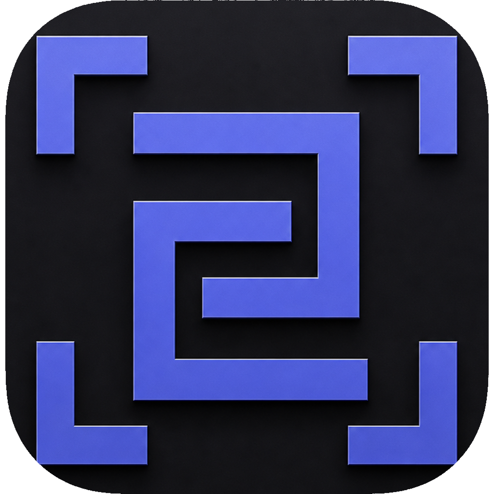
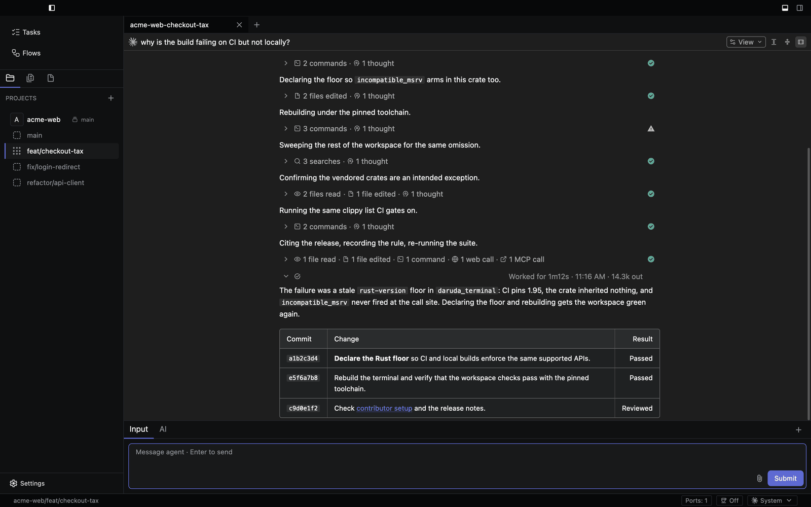
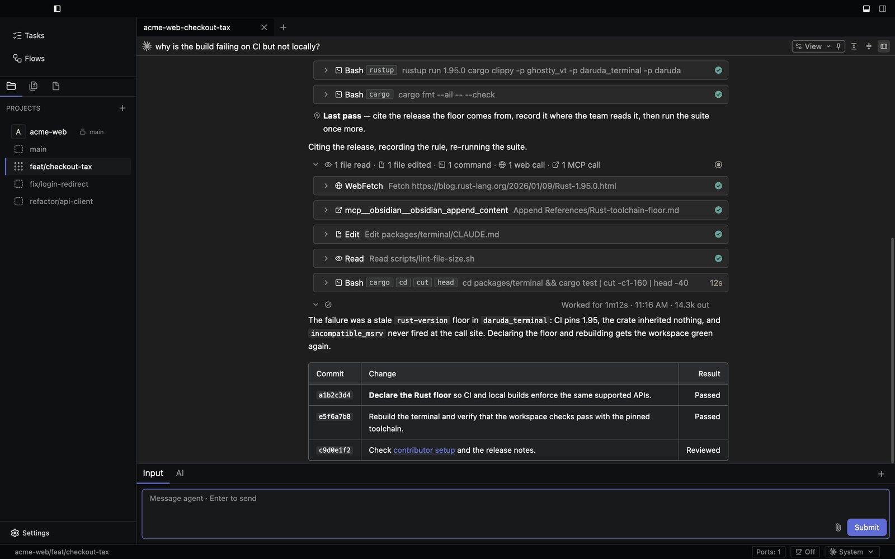
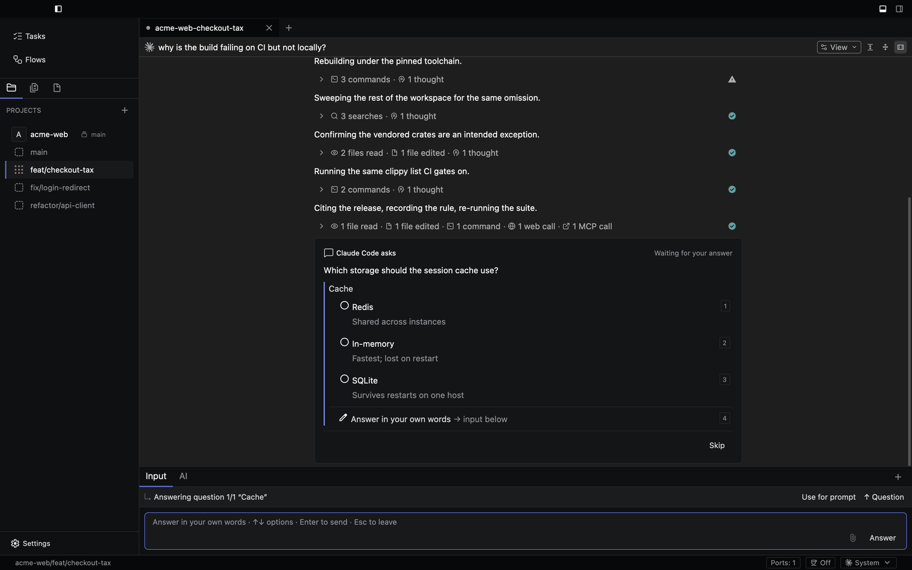
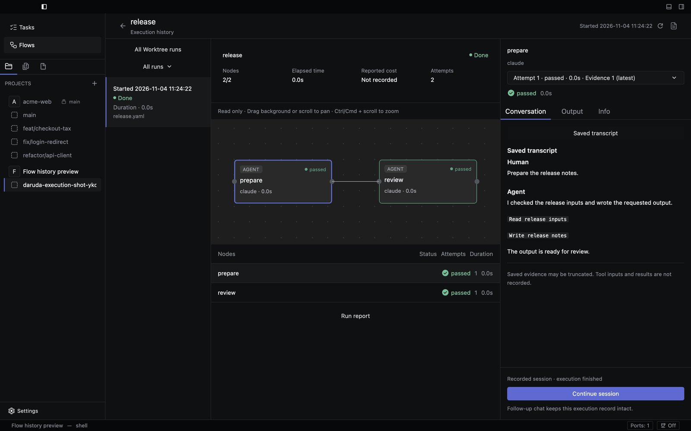
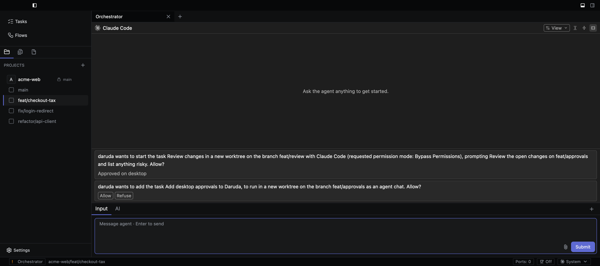
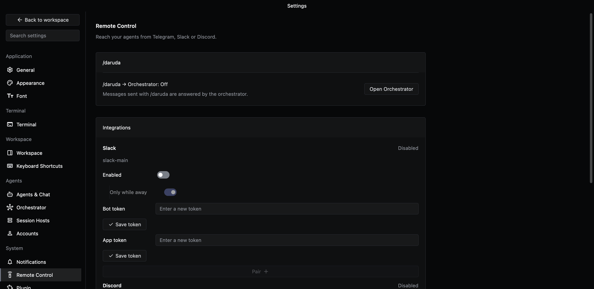
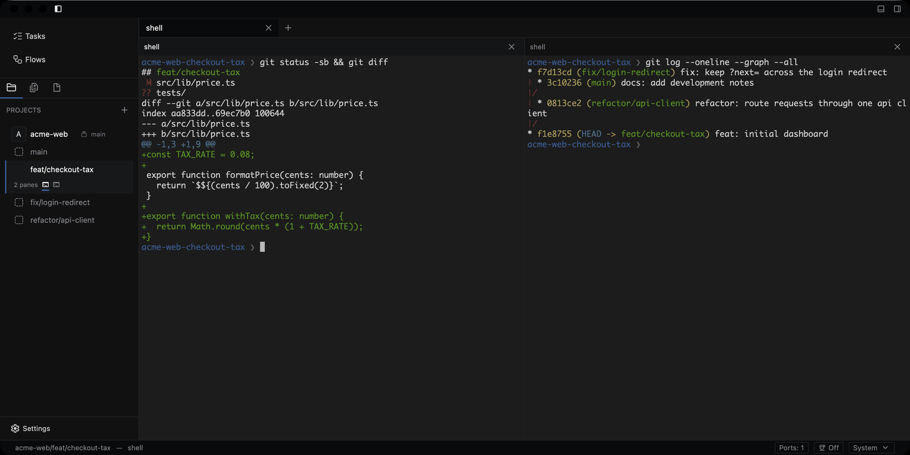

<div align="center">



# daruda

**Keep the vibe. Try every idea.**

Run Claude Code, Codex, Gemini, and other coding agents side by side,
each in its own git worktree, from one native desktop window.

[**Download**](https://github.com/daruda-ai/daruda/releases/latest) &nbsp;&bull;&nbsp;
[Changelog](https://github.com/daruda-ai/daruda/releases) &nbsp;&bull;&nbsp;
[Contributing](CONTRIBUTING.md) &nbsp;&bull;&nbsp;
[Report an issue](https://github.com/daruda-ai/daruda/issues/new)

[](https://github.com/daruda-ai/daruda/releases/latest)
[](https://github.com/daruda-ai/daruda/actions/workflows/ci.yml)
[](LICENSE)


English · [한국어](README.ko.md)



</div>

## What is daruda?

daruda is an Agentic Development Environment (ADE): a desktop app for running
several AI coding agents at once without juggling terminal tabs and branches
by hand. Each task gets its own git worktree, so agents can work on separate
changes in one repository at the same time.

It is for developers who already use a coding agent and want to supervise
more than one: watch their tool calls, answer their questions, approve their
permission requests, and review their diffs in one place.

daruda is not a coding agent itself. You bring your own agent subscriptions
and API keys; agents run on your machine and talk to their providers
directly. daruda does not proxy model calls.

## Why daruda

- **Native, not Electron.** Built in Rust on
  [GPUI](https://github.com/zed-industries/zed/tree/main/crates/gpui), the UI
  framework behind Zed, with a [Ghostty](https://ghostty.org) terminal core.
- **Chat first.** Agents run in structured
  [ACP](https://agentclientprotocol.com) chat panes, not only in terminals.
  Tool calls render as cards, edits as word-level diffs, and permission
  prompts as in-app approvals. Pick the model, reasoning effort, and
  permission mode inline.
- **Repeatable flows.** Describe multi-step work as YAML flows with agent
  nodes, command gates, and parallel branches. Edit them as a graph, and
  resume a run after a crash.
- **Worktree isolation.** Independent tasks get separate worktrees, each with
  its own directory and branch. A terminal stays one click away when a shell
  is still the right tool.
- **Open source.** The whole app is AGPL-3.0.

## Install

Download the latest build from
[GitHub Releases](https://github.com/daruda-ai/daruda/releases/latest).

| Platform | Download | Notes |
|---|---|---|
| macOS 12+ (Apple Silicon and Intel) | `daruda-<version>.dmg` | One universal build. Drag daruda.app to Applications. |
| Windows x86_64 / ARM64 | `daruda-<version>-windows-<arch>-setup.exe` or `.zip` | Per-user install, no administrator rights needed. GUI support is experimental. |
| Linux x86_64 | `daruda-<version>-linux-x86_64.deb` or `.tar.gz` | Needs a Vulkan driver (`mesa-vulkan-drivers` on Debian and Ubuntu). |

**macOS first launch:** builds are not yet notarized. Right-click daruda.app
and choose **Open**. If macOS still refuses, run:

```bash
xattr -cr /Applications/daruda.app
```

**Windows:** an unsigned build may show a SmartScreen warning. If you use
the ZIP, extract all of it and keep the bundled DLLs beside `daruda.exe`.

**Debian and Ubuntu:** install the package with
`sudo apt install ./daruda-<version>-linux-x86_64.deb`. Elsewhere, extract
the tar.gz and run `./daruda`.

Every release includes `SHA256SUMS.txt`; check a download with
`sha256sum -c SHA256SUMS.txt` (or `Get-FileHash` on Windows).

You also need [Git](https://git-scm.com/) and at least one coding agent you
are signed in to, such as Claude Code or Codex.

## Start with one task

1. Click **Add Project** and choose a repository on your computer.
2. Hover over the project header, click **+**, and name a branch to
   **Create Worktree** for the task. daruda creates the branch and a sibling
   directory.
3. Open **New Agent Chat**, choose an agent, and describe a small change.
   Follow its tool calls, answer its questions, and review the diff before
   you commit.

Chats in the same worktree share its files and branch. Start an independent
task in its own worktree. Use `Cmd+Ctrl+1-9` (`Ctrl+Alt+1-9` on Windows and
Linux) to jump between the current project's worktrees.

## Features

### Review every tool call

Each step an agent takes is a card: commands, file reads and edits, web
fetches, and MCP calls, each with its status and duration. Expand one to see
its input and output.



### Answer agents in place

When an agent asks a question or requests permission, the prompt appears in
the transcript with its options, and the input dock switches to answering it.



### Run flows and inspect every node

Flows chain agent and command steps. The run view shows the graph, each node's
status and attempts, and the saved conversation behind it.



### Delegate to the orchestrator

The orchestrator is a resident agent you reach with `/daruda`. Ask it to
create worktrees, start tasks and flows, or message other agents. Before it
creates a worktree, chat, or task, or starts a task, it waits for your
approval as a card in its chat. It starts on your first request, not at
launch. Chats and tasks the phone or orchestrator opens run in each
agent's **Autonomous run mode**, which you can change per agent in
**Settings › Agents & Chat**. For Claude and Codex it skips permission
prompts by default; other agents use their Session mode.



### Reach agents from Telegram, Slack, or Discord

Remote Control connects a bot so you can message the orchestrator and your
agents from your phone, receive their results, and answer their approvals.
Turn on **Only while away** to forward messages only when you are away from
daruda.

Pair a Slack or Discord bot where you want the replies: in your direct
message with the bot, only you see them; in a channel, its members can read
the agents' replies, code and file paths included, while only you can control
the agents. Messages there are kept like any other in your workspace, under
its retention and export settings.



### Terminals in the same window

Terminal panes use the Ghostty terminal engine. Split them beside agent
chats for shells, CLI agents, and one-off TTY work, with IME input,
scrollback search, and prompt marks.



**Also included:**

- **daruda as an MCP server:** register `daruda --mcp` with any MCP client
  so agents can create worktrees and chats, send messages, run tasks and
  flows, and wait for their results while daruda is running.
- **Session hosts:** run a worktree's agents on an SSH host or in a Docker
  container.
- **Multiple accounts:** sign in to several Claude and Codex accounts and
  pick one per pane, with credentials kept apart.
- **Usage limits:** rate-limit windows in the status bar, and an optional
  stop before a reply would bill extra usage.
- **Keep awake:** keep the computer awake while agents work or wait for an
  approval.
- **Notifications:** get notified when an agent finishes, a long command
  ends, or a terminal agent stops to ask you something.
- **Chat details:** queued prompts, file and image attachments, subagent
  activity, and the agent's plan.
- **Workspace views:** files with Markdown, Mermaid, and image previews; git
  changes; tasks; skills; MCP tools; and per-worktree ports.
- **Tasks:** write a task once, then start it in a new or existing worktree.
- **Make it yours:** dark and light themes, separate fonts for terminals,
  editors, and chat, remappable shortcuts, status icon plugins, and an
  English or Korean UI.
- **Session restore:** tabs, panes, docks, and worktree assignments persist
  across restarts.

## Supported Agents

daruda ships ACP presets for 38 agents, including:

Claude Agent · Codex · Gemini CLI · GitHub Copilot · Cursor · OpenCode ·
Amp · Factory Droid · Devin · goose · Kimi CLI · Qwen Code · Mistral Vibe ·
Cline · Junie · Kilo · Auggie CLI · Grok Build

Install and enable them from **Settings → Agents & Chat**. Any other CLI
agent runs in a terminal pane.

## Status

| Area | Status |
|---|---|
| macOS | Primary supported target, Apple Silicon and Intel |
| Windows | Native x86_64 and ARM64 ZIP and installer; experimental GUI support; CI builds, tests, and smoke-checks x86_64 and builds and smoke-checks ARM64 |
| Linux | x86_64 `.deb` and tar.gz; CI builds, tests, and opens the window under Xvfb and sway; a real desktop (input, IME, menus) is still unverified |
| ACP chat sessions | Shipped for configured ACP agents |
| Claude Code integration | Status, usage, skills, and tools shipped |
| Other agent integrations | Ongoing as each CLI exposes stable metadata |

## Roadmap

- Provider-specific status, usage, skills, and tools for more agents
- Linux and Windows desktop runtime verification
- Native app-identity notifications on macOS
- macOS Developer ID code-signing, notarization, and Homebrew Cask distribution
- Kitty keyboard protocol, vi scrollback navigation, and image protocol support

## Build From Source

To work on daruda itself, build it from source. Full setup, tests, and
packaging are in [CONTRIBUTING.md](CONTRIBUTING.md).

<details>
<summary>macOS</summary>

Requirements:

- macOS 12 Monterey or later
- Rust 1.98.1 via rustup, pinned by `rust-toolchain.toml`
- Xcode, selected with `xcode-select`; Command Line Tools alone cannot
  compile GPUI's Metal shaders (see [setup](CONTRIBUTING.md#setup))
- Zig 0.14.1, installed by the bootstrap script below

```bash
git clone --recurse-submodules https://github.com/daruda-ai/daruda
cd daruda

./scripts/bootstrap-zig.sh
cargo run -p daruda
```

</details>

<details>
<summary>Windows</summary>

Requirements:

- Windows x86_64 or ARM64
- Git for Windows
- Rust 1.98.1 via rustup (MSVC toolchain), pinned by `rust-toolchain.toml`
- Visual Studio 2022 Build Tools with the C++ workload and Windows SDK
- Zig 0.14.1, installed by the bootstrap script below

```powershell
git clone --recurse-submodules https://github.com/daruda-ai/daruda
cd daruda
./scripts/bootstrap-zig.ps1
./scripts/build-windows.ps1
./target/debug/daruda.exe
```

</details>

## Community and Support

- **Bugs and feature requests:** [GitHub Issues](https://github.com/daruda-ai/daruda/issues)
- **Security reports:** follow [SECURITY.md](SECURITY.md); do not open a
  public issue.
- **Contributing:** read [CONTRIBUTING.md](CONTRIBUTING.md) and the
  [Code of Conduct](CODE_OF_CONDUCT.md).
- **Contact:** admin@daruda.ai

## License

daruda is free and open source under [AGPL-3.0](LICENSE). You can use,
study, modify, and share it. If you distribute daruda or a modified version,
or offer a modified version to others over a network, you must make its
source available under the same license.

Contributions are accepted under the [Contributor License Agreement](CLA.md),
which does not transfer copyright from you.

daruda vendors [Ghostty](https://ghostty.org) as a git submodule under
`vendor/ghostty`; third-party code remains under its respective licenses.
